# مخطط الكيانات والعلاقات (ERD)

مصدر الحقيقة: `backend/database/migrations/*.sql`. المخطط التالي مبسّط للعلاقات الرئيسية (Mermaid).

```mermaid
erDiagram
  users ||--o{ user_roles : has
  roles ||--o{ user_roles : grants
  roles ||--o{ role_permissions : includes
  permissions ||--o{ role_permissions : in
  users ||--o{ access_scopes : "limited by"
  users ||--o{ api_tokens : "device sessions"
  users ||--|| drivers : "driver profile"
  drivers ||--o{ missions : assigned
  vehicles ||--o{ missions : used_by
  missions ||--o{ mission_events : "state log"
  missions ||--o{ mission_stops : "planned stops"
  missions ||--o{ mission_assignments : "driver history"
  missions ||--o{ vehicle_assignment_history : "vehicle history"
  missions ||--o{ mission_responses : "accept/reject"
  missions ||--o{ mission_routes : versions
  mission_routes ||--o{ route_waypoints : has
  drivers ||--o{ trips : drives
  trips ||--o{ trip_missions : "carries many"
  missions ||--o| trip_missions : "attached once"
  trips ||--o{ vehicle_segments : "vehicle use phases"
  vehicles ||--o{ vehicle_segments : used
  vehicle_segments ||--o{ vehicle_odometer_readings : "start/end"
  trips ||--o{ gps_points : records
  trips ||--o{ trip_stops : "stored once"
  trip_stops ||--o{ trip_stop_missions : "linked to"
  trip_stops ||--o| stop_explanations : explained
  stop_reasons ||--o{ stop_explanations : of
  trip_stops ||--o{ stop_alerts : "5/10 min"
  trips ||--o{ route_deviations : has
  drivers ||--o{ emergency_incidents : raises
  emergency_types ||--o{ emergency_incidents : typed
  emergency_incidents ||--o{ emergency_actions : log
  emergency_incidents ||--o{ emergency_updates : "to driver"
  emergency_incidents ||--o{ emergency_assignments : follow_up
  emergency_incidents ||--o{ emergency_escalations : escalates
  emergency_incidents ||--o{ emergency_attachments : files
  mission_attachments ||--o{ emergency_attachments : is
  missions ||--o{ sms_messages : alerts
  users ||--o{ notifications : receives
  users ||--o{ sync_events : "idempotency"
  users ||--o{ audit_logs : "hash chain"
```

## نقاط تصميمية مهمة
- **Mission / Trip / Segment منفصلة:** `trip_missions` يربط عدة مهام برحلة واحدة؛ `trips.open_flag` (عمود مولّد + فهرس فريد) يمنع وجود رحلتين مفتوحتين لسائق.
- **منع التكرار:** `gps_points (trip_id, client_point_id)` فريد، `sync_events (user_id, event_id)` فريد، `emergency_incidents.client_event_id` فريد، `mission_attachments (uploader, client_file_id)` فريد.
- **التوقف مرة واحدة لكل رحلة:** `trip_stops` على الرحلة، و`trip_stop_missions` يربطه بالمهام المعنية فقط دون تكرار المسافة/المدة في المجاميع.
- **ثلاثة أوقات للعداد:** `measured_at` و`entered_at` و`synced_at` في `vehicle_odometer_readings`.
- **سجل التدقيق:** `audit_logs.prev_hash/row_hash` سلسلة تجزئة؛ التطبيق لا يحدّث ولا يحذف؛ `Audit::verify()` يكشف التلاعب.
- **SMS:** أربع حالات منفصلة في `sms_messages` (طلب، قبول المزود، تسليم، استلام فعلي بالتطبيق).
